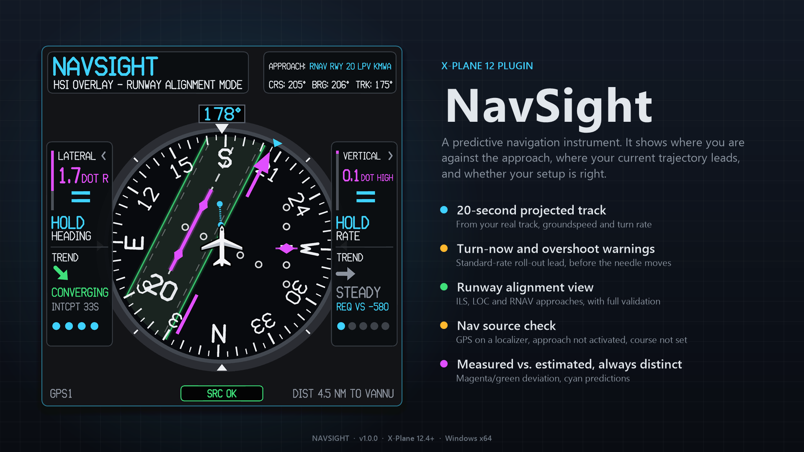
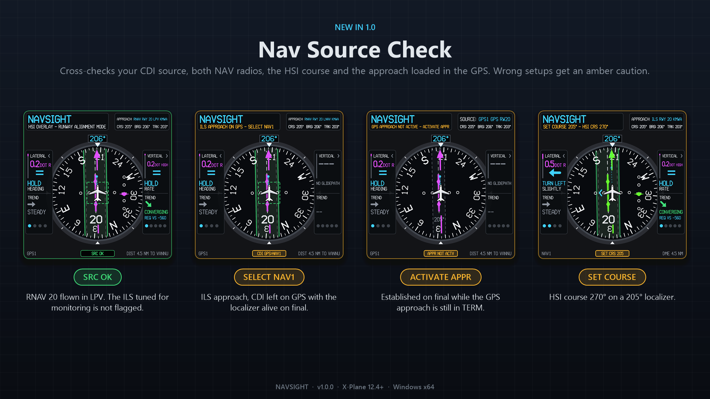

# NavSight



A predictive 2-D navigation instrument plugin for **X-Plane 12** (Windows x64).
NavSight shows where the aircraft is relative to the procedure, where its
current trajectory leads, and whether it is converging, diverging or about to
overshoot. It does this with a heading-up rose, a runway-alignment strip, an
HSI needle and glideslope, a 20-second projected track, and LATERAL / VERTICAL
guidance panels. A **nav source check** also warns when the setup doesn't fit
the procedure: GPS selected on a localizer approach, an approach loaded but
not activated on final, or the HSI course not set.

> Simulation use only. NavSight is not certified avionics or a flight
> director, and must not be used for real-world navigation.

## Features

- **20-second projected track** from your real track, groundspeed and turn
  rate, with turn-now and overshoot warnings.
- **Runway alignment view** for ILS, LOC and RNAV approaches, with signal
  validation and red failure flags.
- **Nav source check**: catches GPS on a localizer approach, an approach not
  activated on final, a localizer for the wrong runway, or the HSI course not
  set.
- **Aircraft-independent**: follows your HSI source (NAV1 / NAV2 / GPS) in any
  aircraft that uses X-Plane's radios. Green needle for ground-based NAV,
  magenta for GPS.
- **Measured vs. estimated, always distinct**: deviations in magenta/green,
  predictions in cyan, cautions in amber.
- Movable, resizable window that pops out to a second monitor; Day / Dim /
  Night brightness; collapsible side panels; manual runway override.



## Install

**Requires** X-Plane 12.4 or newer on Windows 10/11 x64.

1. Download **`NavSight-<version>-win_x64.zip`** from the
   [latest release](https://github.com/Rohank050505/NavSight/releases/latest).
2. Quit X-Plane and unzip the download.
3. Drag the **`NavSight`** folder into `X-Plane 12\Resources\plugins\`:

   ```
   X-Plane 12/
   └── Resources/
       └── plugins/
           └── NavSight/
               └── win_x64/
                   └── NavSight.xpl
   ```

4. Start X-Plane and open **Plugins → NavSight → Show Instrument**.

> Use the zip on the **Releases** page. GitHub's green *Code → Download ZIP*
> button gives you the source code, which X-Plane can't load.

- **Update:** replace the `NavSight` folder with the new one.
- **Uninstall:** delete `Resources\plugins\NavSight` (and optionally
  `Output\preferences\NavSight.prf`).
- **Upgrading from SmartCDI** (NavSight's name before v0.3.0): delete
  `Resources\plugins\SmartCDI`. Settings migrate automatically; key bindings
  move from `smartcdi/…` to `navsight/…` commands.

## Using NavSight

The [User Guide](docs/USER_GUIDE.md) explains every part of the display, the
source check, the runway override, brightness, settings and troubleshooting.

## Build from source

Needs Visual Studio 2022 or newer with the *Desktop development with C++*
workload. With X-Plane closed:

```powershell
git clone https://github.com/Rohank050505/NavSight.git
cd NavSight
.\build.ps1 -Install
```

This downloads the X-Plane SDK on first run, builds the plugin and installs
it into X-Plane. Tests, packaging and debugging:
[docs/BUILDING.md](docs/BUILDING.md).

## Documentation

| Document | For |
|---|---|
| [User Guide](docs/USER_GUIDE.md) | Pilots: install, reading the instrument, settings, troubleshooting |
| [Changelog](CHANGELOG.md) | What changed in each version |
| [Building](docs/BUILDING.md) | Building, testing, packaging, debugging, published datarefs |
| [Architecture](docs/ARCHITECTURE.md) | How the code is organised and why |
| [Algorithms and Math](docs/ALGORITHMS_AND_MATH.md) | Every algorithm, equation and constant |
| [Acceptance](docs/ACCEPTANCE.md) | Test and in-sim evidence for each requirement |

## Repository layout

```
NavSight/
├── src/               plugin source (C++17, X-Plane SDK 4.3)
├── tests/             host-side tests, run without X-Plane
├── docs/              user guide, developer docs, preview images
├── build.ps1          build / test / install / package script
├── CMakeLists.txt     optional CMake build for IDEs and CI
└── CHANGELOG.md
```

Build output goes to `build\` and release zips to `dist\`; neither is
committed. The plugin binary is published only on the Releases page.

## Development Roadmap

### v1.1 — Validation & Testing
- [ ] Implement a dedicated test mode using scripted or recorded `SimSnapshot` data.
- [ ] Create repeatable IFR scenarios for course interception, overshoot, and glidepath tracking.
- [ ] Expand in-simulator validation across aircraft types, navigation sources, wind conditions, and intercept angles.
- [ ] Improve predictive guidance accuracy, uncertainty handling, and navigation-data validation.
- [ ] Document prediction accuracy and known limitations.

### v1.2 — Advanced Procedure Visualization
Expand NavSight beyond final approach guidance to visualize holding patterns, DME arcs, and complex instrument procedure geometry.

**Holding Pattern Visualization**
- [ ] Display holding-pattern geometry, including inbound/outbound legs, holding fix, and turn direction.
- [ ] Visualize direct, parallel, and teardrop holding entries.
- [ ] Display the aircraft's current position and projected trajectory relative to the holding pattern.
- [ ] Incorporate wind correction and drift prediction.
- [ ] Anticipate inbound course interception, outbound timing, and upcoming turns.
- [ ] Provide predictive guidance for maintaining the desired holding pattern.

**DME Arc Visualization**
- [ ] Display the desired DME arc relative to its navigation station.
- [ ] Visualize aircraft position, ground track, and projected trajectory along the arc.
- [ ] Calculate radial distance deviation from the selected arc radius.
- [ ] Predict whether the aircraft is converging toward or diverging from the arc.
- [ ] Anticipate arc interception and potential overshoot.
- [ ] Visualize lead turns and transitions between the arc and subsequent approach segments.
- [ ] Incorporate groundspeed, turn rate, and wind effects into trajectory prediction.

**Procedure Integration**
- [ ] Introduce dedicated display modes for holding patterns and DME arcs.
- [ ] Expand `ApproachResolver` to identify supported procedure legs and geometry.
- [ ] Allow manual procedure configuration when reliable simulator data is unavailable.
- [ ] Add navigation validity checks and automated geometry tests for both procedure types.

### v1.3 — Flight Performance Analytics
- [ ] Record aircraft trajectories, navigation deviations, and instrument procedure events.
- [ ] Develop a dedicated 2-D approach and procedure debriefing interface.
- [ ] Calculate lateral and vertical tracking accuracy.
- [ ] Identify course interception errors, overshoots, and unstable approach conditions.
- [ ] Analyze holding-pattern accuracy and DME arc tracking performance.
- [ ] Compare performance across navigation sources, procedures, and aircraft.
- [ ] Export recorded flight data for external analysis and research.

### v2.0 — Cockpit & Companion Application Integration
- [ ] Develop a native 3-D cockpit instrument using the XPLM400 Avionics API.
- [ ] Reuse the existing `InstrumentRenderer` through a dedicated avionics display host.
- [ ] Create a companion desktop application for instrument configuration and flight analysis.
- [ ] Implement UDP/WebSocket communication for streaming navigation and instrument state.
- [ ] Develop a compact, text-only supplementary overlay for traditional cockpit instruments.
- [ ] Support external monitors and home cockpit hardware.
- [ ] Introduce customizable instrument layouts and display preferences.

### Future Development — Compatibility & Research
- [ ] Expand compatibility with custom avionics and aircraft-specific data sources.
- [ ] Support copilot-side navigation data and independent instrument configurations.
- [ ] Investigate alternative rendering backends, including the X-Plane Panel Graphics API.
- [ ] Explore macOS and Linux compatibility.
- [ ] Investigate advanced trajectory prediction incorporating aircraft performance characteristics.
- [ ] Conduct human-factors research comparing conventional navigation instruments with NavSight.
- [ ] Evaluate improvements in situational awareness, course interception accuracy, and pilot workload.
